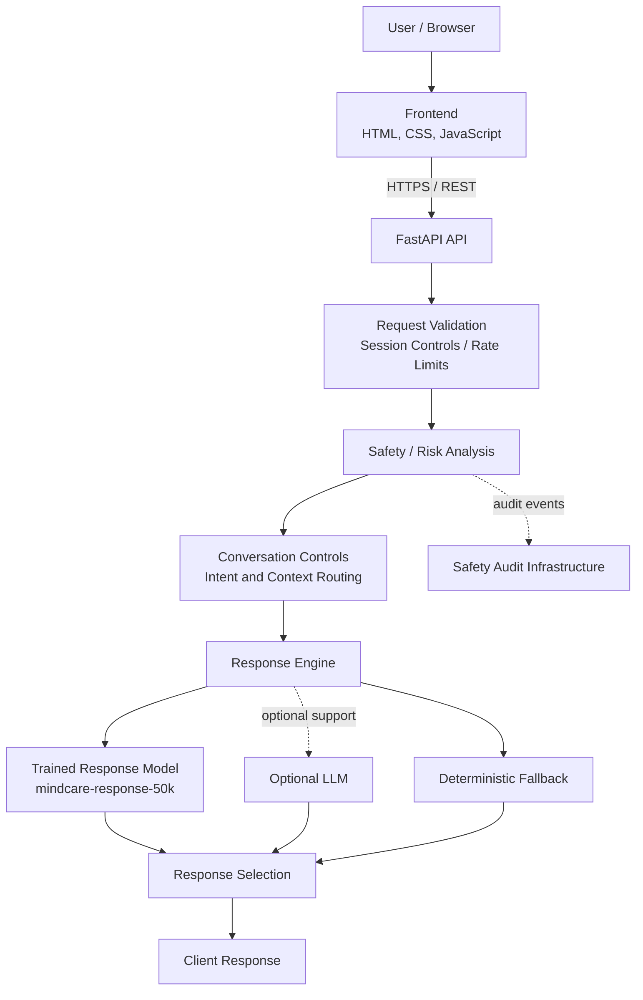

MindCare AI
Safety-First Supportive Conversational AI
A full-stack AI/ML application built around a central engineering principle: safety and risk decisions should remain separate from response generation.

Explore a layered conversational system with independent safety analysis, context-aware routing, a trained 50K-message response model, deterministic fallback behavior, a FastAPI backend, regression tests, and a deployed web interface.

  
  
  

  
  
  
  
  
  

Contents
- Overview
- Engineering highlights
- Architecture
- AI/ML pipeline
- Dataset and reported evaluation
- Safety-oriented design
- Backend and security
- API reference
- Technology stack
- Repository structure
- Run locally
- Docker workflow
- Deployment
- Testing and quality assurance
- Engineering scope
- Project status
- Roadmap
- Responsible AI and limitations
- Developer
- License
Overview
MindCare AI is a supportive conversational application designed to respond to everyday emotional and situational concerns, including stress, loneliness, uncertainty, difficult days, and academic pressure.

Conversational systems require more than generating plausible text. They also need to interpret the user's context, handle sensitive language carefully, route messages appropriately, manage sessions, validate requests, and preserve expected behavior as the system changes.

MindCare brings those concerns together in a single software project. Its architecture separates safety/risk analysis from response generation, then routes the conversation through a layered response engine. The application is backed by a FastAPI REST API and a browser-based frontend, with regression tests and Docker support.

Project links
- Live application: mindcare-ai-o1e5.onrender.com
- Backend health endpoint: mindcare-ai-semb.onrender.com/health
- Source repository: AI-Mental-health-chatbot on GitHub
Design principle: the response-generation model is not the sole authority for safety or risk decisions.

Engineering highlights
Area	What the project implements
Safety-oriented architecture	A distinct safety/risk analysis layer before response generation
Context handling	Recognition of relevant negation and contextual signals
Conversation routing	Routing for different conversational contexts, including exam stress and loneliness
Response system	mindcare-response-50k, trained/evaluated using a 50,000-message dataset
Layered response engine	Trained response model, optional LLM support, and deterministic fallback as distinct components
API engineering	FastAPI endpoints and Pydantic request validation
Session lifecycle	Session creation, lookup, expiration, deletion, and configured limits
Request controls	Separate rate limits for chat and session creation
Security configuration	Configurable CORS and security-related response headers
Auditability	Safety audit infrastructure and audit-related endpoints
Quality assurance	Regression tests covering API, safety, routing, session behavior, and response integration
Delivery	Frontend and backend deployed separately on Render; Docker Compose support for container workflows

The table describes the implementation as supplied in the project documentation. Live availability, current test results, and deployment configuration can change and should be checked against the current repository and services.
Architecture
The request flow is designed to keep safety decisions distinct from the response-generation components.

Request lifecycle
1. Receive and validate: the API accepts a request and validates its structure.
2. Apply request/session controls: session and rate-limit rules are applied.
3. Analyze safety and risk: the dedicated behavior layer evaluates relevant indicators and context.
4. Route the conversation: intent and conversational context help determine the appropriate response path.
5. Select a response: the response engine can use the trained response model, optional LLM support where configured, or deterministic fallback behavior.
6. Return the result: the API returns a response to the frontend.
The diagram shows the available response components, not a guarantee that every component runs for every request. Safety/risk decisions are not delegated solely to the response-generation model.
AI/ML pipeline
The response system is identified as mindcare-response-50k. The supplied project documentation describes a dataset preparation and evaluation workflow, response-model integration, retrieval/similarity evaluation, and regression testing.
Synthetic conversational dataset
             |
             v
Dataset preparation and split checks
             |
             v
Training / validation / test datasets
             |
             v
Model and response-system evaluation
             |
             v
Response-model integration
             |
             v
Safety analysis + conversation routing
             |
             v
Layered response engine
             |
             v
Regression testing after changes
The reported workflow includes:
- Dataset preparation with separate training, validation, and test splits.
- Evaluation of intent/risk, mood, and topic predictions.
- Retrieval/similarity evaluation.
- Integration of the response model into the response engine.
- Separation of safety/risk decisions from response generation.
- Regression testing to detect unintended changes in routing or response behavior.
The supplied information does not establish the model's specific algorithm, embedding model, vector database, or complete training implementation, so those details are intentionally not inferred here.
Dataset and reported evaluation
The project documentation describes the following synthetic development/training dataset and evaluation results.
Dataset summary
Property	Reported value
Total messages	50,000
Training split	40,000 (80%)
Validation split	5,000 (10%)
Test split	5,000 (10%)
Intents	20
Messages per intent	2,500
Unique response texts	18,009
Normalized message duplicates	0
Cross-split normalized message overlap	0
English examples	43,556 (87.11%)
Hinglish examples	6,444 (12.89%)
High-risk-labeled rows	2,500

The documented dataset includes general conversation, loneliness, anxiety, difficult days, uncertainty, sleep-related concerns, study and work pressure, exam stress, and safety-oriented examples.
Reported development metrics
Metric	Reported result
Intent / risk accuracy	1.0000
Mood accuracy	approximately 0.867
Topic accuracy	approximately 0.868
Mean retrieval similarity	approximately 0.8587

These values are reported project evaluation results, not independently reproduced benchmarks. In particular, an intent/risk accuracy of 1.0000 should be interpreted in the context of dataset construction, labeling quality, class balance, evaluation design, and the use of synthetic examples. It does not establish performance on real-world conversations.

The documented zero normalized-duplicate and cross-split-overlap counts reduce certain forms of direct data leakage risk. They do not prove semantic independence: paraphrases, near-duplicates, template similarities, or other sources of leakage may still exist. The figures should not be interpreted as evidence of clinical effectiveness, generalization to real users, or safety certification.
Safety-oriented design
MindCare's architecture separates safety/risk analysis from response quality. This matters because a fluent or empathetic response is not, by itself, evidence that a sensitive message has been routed correctly.

The supplied implementation describes signals and contextual factors including:
- Crisis and self-harm indicators.
- Intent, plan, hopelessness, and worthlessness signals.
- Protective signals.
- Negation and temporal/contextual information.
Negation and context
A keyword-only approach can misinterpret a message when it sees a sensitive term without understanding how it is used. MindCare includes handling for recognized negated safety phrases before evaluating relevant crisis/self-harm patterns.

Illustrative examples used to explain expected routing behavior:
Example message	Intended consideration
“I am not suicidal and I do not want to hurt myself.”	Recognized negation should be considered rather than escalating on isolated keywords alone.
“My exams are coming and I have not studied.”	Academic and exam-stress context should inform routing.
“I feel lonely today.”	Loneliness should not automatically be treated as the same category as every other emotional message.

These examples illustrate intended test behavior; they are not a guarantee of correct interpretation for every phrasing, language, or context. Rule-based and ML-based systems can both miss nuance, misunderstand ambiguous language, or behave differently on data outside their evaluation set. Regression tests help detect known behavioral regressions but cannot prove that every safety-sensitive case is handled correctly.
Backend and security
The backend uses FastAPI and Pydantic validation. The supplied project description documents these engineering controls:
- Request validation for required fields, session identifiers, message length, and payload structure.
- Session creation, lookup, expiration, deletion, and configurable session limits.
- Separate rate-limit controls for chat requests and session creation.
- Configurable Cross-Origin Resource Sharing (CORS).
- Security-related response headers.
- Health, liveness, and readiness endpoints.
- Safety audit infrastructure and audit-related API routes.
Security headers
The documented examples include:
X-Content-Type-Options: nosniff
X-Frame-Options: DENY
Referrer-Policy: no-referrer
Cache-Control: no-store
These headers contribute to browser-side security behavior, but they do not by themselves establish that an application is secure. Authentication, encryption-at-rest, regulatory compliance, and durable audit retention are not claimed here because the supplied project information does not establish them.
API reference
The following routes are listed in the supplied project documentation. Confirm their exact schemas and behavior against the current backend implementation before integrating another client.
Method	Endpoint	Purpose
GET	/	API information
GET	/health	Health check
GET	/health/live	Liveness check
GET	/health/ready	Readiness information
POST	/session	Create a conversation session
POST	/chat	Send a message
DELETE	/session/{session_id}	Delete a session
GET	/api/status	API status/configuration
GET	/api/audit/count	Audit record count
GET	/api/audit/recent	Recent audit records

Example chat request
POST /chat
Content-Type: application/json
{
  "session_id": "YOUR_SESSION_ID",
  "message": "I have exam stress"
}
A response may include fields similar to the following, based on the supplied project documentation. This is an illustrative shape, not a guaranteed response contract; actual field names, values, and status codes should be checked in the implementation.
{
  "session_id": "example-session-id",
  "mode": "example-mode",
  "risk_level": "low",
  "risk_score": 0.05,
  "signals": {},
  "context": {},
  "response_source": "trained_response_model",
  "response_model": "mindcare-response-50k",
  "decision_source": "example-source",
  "reply": "Example response text"
}
Do not use the example session identifier as a real credential or assume the example values are representative of every request.
Technology stack
Category	Technologies
Backend	Python 3.11, FastAPI, Uvicorn, Pydantic, python-dotenv
AI/ML and data	NumPy, Pandas, Scikit-learn, mindcare-response-50k, retrieval/similarity evaluation, optional LLM integration
Frontend	HTML5, CSS3, JavaScript
Testing and development	pytest, Git, GitHub, Python virtual environments, REST APIs
Deployment and infrastructure	Render, Docker, Docker Compose

Repository structure
The following is a representative structure based on the supplied project documentation, not a fresh verification of every path in the current GitHub checkout.
AI-Mental-health-chatbot/
├── app/
│   ├── main.py
│   ├── behavior_engine.py
│   ├── response_engine.py
│   ├── response_model.py
│   ├── logging_config.py
│   ├── production_config.py
│   ├── safety_audit.py
│   ├── security.py
│   ├── session_manager.py
│   └── ml/
│       ├── hybrid_engine.py
│       └── rule_engine.py
├── Frontend/
│   ├── index.html
│   ├── script.js
│   ├── styles.css
│   └── README.md
├── data/
│   └── mindcare_responses/
│       ├── train.csv
│       ├── validation.csv
│       ├── test.csv
│       ├── dataset_audit.json
│       └── README.md
├── models/
│   └── response_model/
├── scripts/
│   └── evaluate_response_diversity.py
├── tests/
│   ├── test_api_security_regression.py
│   └── test_natural_response_regression.py
├── Dockerfile
├── docker-compose.yml
├── pytest.ini
├── requirements.txt
├── README.md
└── .env.example
Some model and test files may differ between revisions. Use the actual repository tree as the source of truth when navigating or updating the project.
Run locally
Prerequisites
- Python 3.11
- Git
- A terminal
- Optional: Docker and Docker Compose for container-based local development
1. Clone the repository
git clone https://github.com/AnshPratap2314/AI-Mental-health-chatbot.git
cd AI-Mental-health-chatbot
2. Create and activate a virtual environment
macOS / Linux
python3.11 -m venv .venv
source .venv/bin/activate
Windows — Command Prompt
py -3.11 -m venv .venv
.venv\Scripts\activate.bat
Windows — PowerShell
py -3.11 -m venv .venv
.\.venv\Scripts\Activate.ps1
3. Install dependencies
python -m pip install --upgrade pip
pip install -r requirements.txt
4. Configure environment variables
If .env.example is present in the checkout, copy it to .env:
cp .env.example .env
On Windows Command Prompt, use:
copy .env.example .env
Populate the variables required by the local configuration. Treat .env.example as the authoritative list of variable names; do not assume variables that are not documented there. Never commit API keys, credentials, or production secrets.
5. Start the backend
The supplied project instructions use this command:
uvicorn app.main:app --reload --host 127.0.0.1 --port 8000
The API should then be available at http://127.0.0.1:8000, with the documented health route at http://127.0.0.1:8000/health, if those paths match the current checkout.
6. Start the frontend
In a second terminal, activate the environment if needed, then run:
cd Frontend
python -m http.server 5500
Open http://localhost:5500 in your browser.

Ensure the frontend's configured backend API URL points to the local backend and that the backend's CORS allowlist permits the frontend origin. The exact frontend configuration key should be confirmed in the current source rather than guessed.
Docker workflow
Docker and Docker Compose support are documented for local/container workflows. The actual service names and port mappings are defined by the repository's Dockerfile and docker-compose.yml.

Build and start the services:
docker compose up -d --build
Inspect container status:
docker compose ps
Check the documented example health URL, after confirming the current port mapping:
curl http://127.0.0.1:8001/health
Stop the services:
docker compose down
The port in the health-check example must match the current Compose configuration. Docker support does not imply that production is deployed through Docker.
Deployment
The supplied deployment documentation describes two separate Render services:
Component	Render service type	URL
Frontend	Static Site	mindcare-ai-o1e5.onrender.com
Backend	Web Service	mindcare-ai-semb.onrender.com
Backend health endpoint	Health route	Open /health

The documented production topology uses HTTPS REST communication between the browser frontend and FastAPI backend.
Deployment configuration checklist
When deploying or reproducing the setup, check:
1. Frontend API URL: the frontend must target the intended backend service.
2. CORS origins: the backend allowlist must include the deployed frontend origin.
3. Environment variables: configure the variables required by the current application; do not copy secrets into source control.
4. Health-check path: make sure the configured Render health path matches an implemented backend route.
5. Deployment logs: review frontend build/runtime output and backend startup logs when troubleshooting.
These URLs and service types come from the supplied project documentation. Their present availability and configuration should be checked directly; this README does not assert that the endpoints are healthy at the time you read it.
Testing and quality assurance
The project documentation reports a regression-suite result of 238 passing tests. This is a reported result, not a newly reproduced run against the current checkout.

Run the suite locally:
pytest -q
The supplied documentation describes coverage across these areas:
- API behavior and request validation.
- API security and CORS configuration.
- Session lifecycle and request controls.
- Safety behavior and negation-related regression cases.
- Conversation routing.
- Response-model integration and natural-response behavior.
- Regression cases for previously handled scenarios.
Regression testing is particularly important in a conversational system: changes to data, routing, safety rules, or response selection can alter behavior beyond the feature being changed. Re-run the tests after relevant modifications and investigate failures against the current implementation.
Engineering scope
MindCare demonstrates work across multiple layers of an AI-enabled application.

AI/ML and data preparation
- Prepared and documented a 50,000-message synthetic dataset with train, validation, and test splits.
- Reported intent/risk, mood, topic, and retrieval/similarity evaluation results.
- Integrated a named response model into a broader response engine.
Safety-oriented system design
- Kept safety/risk analysis architecturally separate from response generation.
- Included recognized negation and contextual signals in safety-oriented handling.
- Added audit infrastructure and regression cases for sensitive conversational behavior.
Backend engineering
- Built a FastAPI REST interface with request validation.
- Implemented session lifecycle controls and rate limiting.
- Configured CORS, security headers, and health-related endpoints.
Software quality and delivery
- Documented a regression-testing workflow.
- Added Docker and Docker Compose support.
- Deployed the frontend and backend as separate Render services, as reported in the project documentation.
- Documented local setup, API routes, configuration considerations, and known limitations.
These are implementation-scope descriptions, not claims of clinical effectiveness, business impact, or independently verified production reliability.
Project status
Status below distinguishes documented implementation from information that should be checked in the current checkout or live environment.
Area	Status based on supplied documentation
Safety/risk layer and context routing	Documented as implemented
mindcare-response-50k integration	Documented as integrated
Session management and rate limiting	Documented as implemented
CORS and security headers	Documented as configured
Safety audit infrastructure	Documented as implemented
Regression suite	238 passing tests reported; rerun to confirm current status
Frontend/backend Render deployment	Deployment reported; live status requires current verification
Docker / Docker Compose	Support documented; verify against current configuration
Current endpoint availability	Requires live verification
Current repository tree and exact API schemas	Requires checkout-level verification
Clinical validation	Not established
Open-source license	Not specified in the supplied information

Roadmap
The following are potential future improvements, not claims of existing functionality:
- Build evaluation sets reviewed or authored by humans.
- Expand English/Hinglish coverage and multilingual robustness testing.
- Develop more rigorous safety benchmarks and adversarial test cases.
- Evaluate response relevance and semantic quality beyond similarity metrics.
- Add structured human-review workflows.
- Improve operational observability and error analysis.
- Introduce explicit model and dataset version management.
- Explore privacy-aware conversation memory with clear user controls.
- Improve accessibility and usability.
- Add or strengthen CI/CD automation.
- Reassess containerized production deployment if it fits the project's operational needs.
Responsible AI and limitations
MindCare AI is an educational and engineering project focused on supportive conversational AI.
- It is not a medical diagnosis or treatment tool.
- It is not a substitute for a qualified mental-health professional.
- It is not an emergency response service.
- The documented 50K-message dataset is synthetic development/training data.
- The supplied metrics are engineering evaluation results, not clinical validation.
- No clinical validation, safety certification, or real-world efficacy has been established by the information available for this README.
- A response that appears supportive may still be inaccurate, incomplete, or inappropriate for a particular person or situation.
Do not rely on this application as the sole source of support for urgent or high-risk situations. Seek qualified professional or emergency support when needed.
Developer

Ansh Pratap
B.Tech Computer Science & Engineering
Mewar University · Rajasthan, India

AI/ML Engineering · Python · NLP and Conversational Systems · FastAPI · Software Testing · Responsible AI

  
  

License
The intended license has not been specified in the supplied project information. Before distributing the project for public reuse, select an appropriate license and add a LICENSE file to the repository. Until then, do not assume the code is available for unrestricted reuse.

MindCare AI — safety-aware conversational AI, engineered as a complete software system.

Try the live demo · Explore the source code

Python · FastAPI · Machine Learning · JavaScript · Regression Testing · Responsible AI

